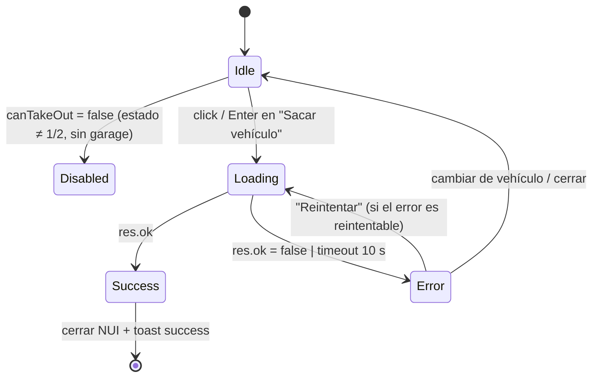

# mdp_garages — Sistema de diseño (NUI)

> Stack: **React + TypeScript + Tailwind CSS v4 + Untitled UI React (solo componentes FREE)**, empaquetado con **Vite**.
> Base: tema oficial de Untitled UI (`styles/theme.css` de [untitleduico/react](https://github.com/untitleduico/react), licencia MIT, commit `1d410cb` revisado el 16/10/2026) en **modo oscuro**. Solo personalizamos la **escala de marca (brand)** y algunos acentos. Todo lo demás (grises, success/warning/error, sombras, radios, espaciado, tipografía) es el de Untitled UI sin tocar.

## 0. Arquitectura e integración

### Build (obligatorio)
React + Tailwind v4 **requiere paso de build**. FiveM sirve archivos estáticos: compilar con Vite y apuntar `ui_page` al resultado.
```
web/            ← proyecto Vite (src/, index.html, package.json)
web/dist/       ← salida de `vite build` (esto es lo que carga FiveM)
```
`fxmanifest.lua`: `ui_page 'web/dist/index.html'` y `files { 'web/dist/index.html', 'web/dist/assets/*' }`.
`vite.config.ts`: `base: './'` (rutas relativas, NUI usa `https://cfx-nui-<recurso>/`), plugin `@tailwindcss/vite`.
Componentes: `npx untitledui@latest add button badge ...` (CLI) o copiar desde el repo; se copian al proyecto, no hay dependencia runtime pesada. Dependencias que arrastran: `react-aria-components`, `tailwind-merge`, `@untitledui/icons`. Para toasts: `sonner` (ya es dependencia del repo de UUI).

### Orden de importación del CSS
Theme de Untitled UI en `web/src/styles/theme.css`. Orden efectivo:
```ts
// web/src/main.tsx
import '@/styles/globals.css'; // @import "tailwindcss"; theme.css; typography.css (Untitled UI)
import '../tokens.css';        // mdp_garages: override — SIEMPRE después
```
Reglas de `web/tokens.css`:
- Solo nombres **reales** de `src/styles/theme.css` (verificados uno a uno): `--font-body`, `--font-display`, `--color-brand-50…950`, y en `.dark-mode`: `--color-focus-ring`, `--color-border-brand`, `--color-text-brand-secondary`, `--color-fg-brand-primary`. Sin variables `--mdp-*`.
- CSS **sin `@layer`** → gana a `@layer theme/base`. No hace falta `@theme` propio: `--font-display` y `--font-body` ya están registrados en el `@theme` de theme.css, así que `font-display`/`font-body` existen y leen el valor sobrescrito.
- Tokens globales en `:root`; los de modo oscuro en `.dark-mode` (mismo selector que theme.css; `<html class="dark-mode">`).
- Las clases semánticas (`bg-brand-solid`, `text-brand-secondary`, `ring-focus-ring`…) heredan el nuevo brand automáticamente.

### Fuentes (self-hosted, sin Google Fonts)
`web/src/assets/fonts/`: subsets **latin** y **latin-ext** en woff2 — `inter-{latin,latin-ext}-{400,500,600,700}-normal.woff2`, `rajdhani-{latin,latin-ext}-{600,700}-normal.woff2` (12 archivos, @fontsource v5 vía jsDelivr) + `OFL-Inter.txt`, `OFL-Rajdhani.txt` (SIL OFL 1.1). Cada `@font-face` lleva el `unicode-range` exacto de fontsource, así el navegador solo descarga latin-ext si aparece un carácter de ese rango (p. ej. ł, ő, ș). Los `@font-face` de tokens.css usan URLs relativas (`./src/assets/fonts/…`); Vite las hashea a `dist/assets/` y con `base: './'` quedan como `url(./…)`, válidas en `cfx-nui-`.

### Consideraciones NUI
- **Resolución base 1920×1080.** Contenedor fijo 1180×680 centrado. Escala: `--app-scale = Math.min(innerWidth/1920, innerHeight/1080)` aplicado con `transform: scale()` en el contenedor (recalcular en `resize`). No usar `vw` para tipografía.
- **Fondo transparente**: `html, body, #root { background: transparent }` (incluido en tokens.css). Solo el panel tiene fondo `bg-primary`.
- Sin dependencias externas pesadas: nada de CDN en runtime. **Fuentes self-hosted** (ver arriba). Iconos: `@untitledui/icons` (tree-shaking).
- CEF de FiveM (Chromium moderno): soporta `oklch`, `color-mix`, CSS nesting → Tailwind v4 OK.
- `user-select: none`, foco por teclado visible, `Esc` cierra (`SetNuiFocus(false,false)`).
- Animaciones ≤ 300 ms y solo `opacity`/`transform` (rendimiento en juego).

## 1. Paleta

### 1.1 Marca (custom) — "MDP Electric Azure"
Nota: theme.css de UUI define brand 50–950 (no existe `--color-brand-25`), por eso la escala empieza en 50.
Azul eléctrico, frío y premium; destaca sobre los neutros de UUI sin chocar con success/warning/error.

| Token | Hex | Uso principal |
|---|---|---|
| `--color-brand-50`  | `#EBF3FF` | |
| `--color-brand-100` | `#D6E7FF` | |
| `--color-brand-200` | `#B2D0FF` | |
| `--color-brand-300` | `#84B2FF` | `text-brand-secondary` (dark, override) |
| `--color-brand-400` | `#5792FF` | `focus-ring`, `border-brand`, `fg-brand-primary` (dark, override) |
| `--color-brand-500` | `#3373FF` | acento, borde de tarjeta seleccionada |
| `--color-brand-600` | `#1F5CF0` | `bg-brand-solid` → **Button primary** |
| `--color-brand-700` | `#1848CC` | hover/pressed |
| `--color-brand-800` | `#193CA3` | |
| `--color-brand-900` | `#1A3480` | |
| `--color-brand-950` | `#101F4F` | fondos de Badge/Featured icon brand en dark |

### 1.2 Capas y texto (Untitled UI dark, sin override; neutros de Tailwind)
| Rol | Variable UUI | Valor dark | Hex aprox. |
|---|---|---|---|
| Fondo app (panel) | `--color-bg-primary` | neutral-950 | `#0A0A0A` |
| Superficie (tarjetas) | `--color-bg-secondary` | neutral-900 | `#171717` |
| Superficie elevada / hover | `--color-bg-tertiary` | neutral-800 | `#262626` |
| Overlay modal | `--color-bg-overlay` | neutral-800 (+opacidad en Modal) | `#262626` |
| Borde fuerte | `--color-border-primary` | neutral-700 | `#404040` |
| Borde suave | `--color-border-secondary` | neutral-800 | `#262626` |
| Texto 1 | `--color-text-primary` | neutral-50 | `#FAFAFA` |
| Texto 2 | `--color-text-secondary` | neutral-300 | `#D4D4D4` |
| Texto 3 | `--color-text-tertiary` | neutral-400 | `#A1A1A1` |
| Texto 4 / placeholder | `--color-text-quaternary` | neutral-500 | `#737373` |

### 1.3 Estados (Untitled UI, sin override)
| Estado | fg (dark) | Hex | Clase/uso |
|---|---|---|---|
| Éxito | `--color-fg-success-primary` = green-500 | `#22C55E` | Badge `success`, barras ≥60 |
| Aviso | `--color-fg-warning-primary` = yellow-500 | `#EAB308` | Badge `warning`, barras 30–59 |
| Peligro | `--color-fg-error-primary` = red-500 | `#EF4444` | Badge `error`, barras <30, botones destructivos |
| Info | marca (`brand`) | `#3373FF` | toasts info |

## 2. Tipografía
- **Cuerpo/UI:** Inter (variable UUI `--font-body`, por defecto).
- **Display (títulos, nombres de vehículo):** **Rajdhani 600/700** → override `--font-display`. Usar clase `font-display` + `uppercase` en títulos de pantalla.
- **Mono (matrícula, porcentajes):** `--font-mono` de UUI.
- Escala: la de UUI (`text-xs` 12, `text-sm` 14, `text-md` 16, `text-lg` 18, `text-xl` 20, `display-xs` 24, `display-sm` 30, `display-md` 36). Pesos: 400 / 500 / 600 / 700.
- Uso: título pantalla `font-display text-display-sm font-bold uppercase`; nombre vehículo en tarjeta `font-display text-xl font-semibold`; en detalle `text-display-md`; etiquetas de barras `text-xs font-semibold uppercase tracking-wider text-tertiary`.

## 3. Espaciado, radios, sombras, movimiento (todo UUI/Tailwind)
- **Espaciado:** escala Tailwind (`--spacing` = 4px): 1=4, 2=8, 3=12, 4=16, 5=20, 6=24, 8=32, 10=40, 12=48. Padding panel `p-6`, gap lista `gap-2`, padding tarjeta `px-4 py-3`.
- **Radios:** `rounded-md` (6) inputs pequeños/matrícula, `rounded-lg` (8) botones/inputs, `rounded-xl` (12) tarjetas/hero, `rounded-2xl` (16) contenedor y modal, `rounded-full` badges.
- **Sombras:** `shadow-xs` botones/inputs, `shadow-lg` tarjeta seleccionada, `shadow-xl` modal, `shadow-2xl` contenedor principal. Foco: `ring-4 ring-focus-ring/24` (patrón UUI).
- **Movimiento:** `duration-100` hover, `duration-200` selección, `duration-300 ease-out` entrada de panel (fade + scale 0.96→1), barras `transition-[width] duration-500`. Respetar `motion-reduce:`.

## 4. Componentes (Untitled UI) — verificación FREE / PRO

Método de verificación: (a) presencia del componente en el repo open-source MIT `github.com/untitleduico/react` (= FREE); (b) página `untitledui.com/react/components/<slug>` con comando `npx untitledui@latest add` público. Revisado 16/10/2026.

| Parte de la UI | Componente UUI exacto | Archivo en repo | Estado | Dónde se confirmó |
|---|---|---|---|---|
| Botones | **Button** (`primary`, `secondary`, `tertiary`, `link-*`, `primary-destructive`, `secondary-destructive`, `tertiary-destructive`) | `components/base/buttons/button.tsx` | FREE | repo + /react/components/buttons |
| Cerrar panel/modal | **CloseButton** (Buttons) | `components/base/buttons/close-button.tsx` | FREE | repo |
| Estado del vehículo, categoría | **Badge**, **BadgeWithDot** (`type="pill-color"`) | `components/base/badges/badges.tsx` | FREE | repo + /react/components/badges |
| Motor/carrocería/combustible | **Progress bar** (`ProgressBar`, `ProgressBarBase`) | `components/base/progress-indicators/progress-indicators.tsx` | FREE | repo + /react/components/progress-indicators |
| Filtros | **Tabs** (`Tabs`, `TabList`, `Tab`, `TabPanel`) | `components/application/tabs/tabs.tsx` | FREE | repo + /react/components/tabs |
| Búsqueda | **Input** (con `icon`) | `components/base/input/input.tsx` | FREE | repo + /react/components/inputs |
| Icono destacado / hero | **Featured icon** | `components/foundations/featured-icon/featured-icon.tsx` | FREE | repo + /react/components/featured-icons |
| Garaje vacío | **Empty state** | `components/application/empty-state/empty-state.tsx` | FREE | repo + /react/components/empty-states |
| Confirmaciones | **Modal** (`ModalOverlay`, `Modal`, `Dialog`) | `components/application/modals/modal.tsx` | FREE (primitiva) | repo. ⚠ Los *ejemplos* prediseñados de la página /react/components/modals pueden ser PRO: construir el contenido con Featured icon + Button |
| Carga | **Loading indicator** | `components/application/loading-indicator/loading-indicator.tsx` | FREE | repo |
| Tooltips (atajos) | **Tooltip** | `components/base/tooltip/` | FREE | repo |
| Toasts | **Notifications** | — (no está en repo) | **PRO** ❌ | /react/components/notifications marcada PRO, sin comando `add` público |
| Aviso de incautado | **Alerts** | — (no está en repo) | **PRO** ❌ | no existe en repo open-source |

**Alternativas FREE a los PRO**
- **Toast/notification (PRO)** → `sonner` (`<Toaster theme="dark" position="top-right" />` + `toast.custom()`) renderizando un contenido propio con **Featured icon** + texto + **CloseButton**, usando tokens UUI. `sonner` ya figura como dependencia en el repo de UUI.
- **Alerts (PRO)** → bloque custom `div` con `bg-error-primary border border-error-subtle rounded-xl` + **Featured icon** `color="error"` + **Button**.

### 4.1 Button
| Variante del diseño | Prop UUI | Uso |
|---|---|---|
| Primary | `color="primary"` | Sacar vehículo / Guardar vehículo |
| Secondary | `color="secondary"` | Transferir, Cancelar, Marcar en GPS |
| Ghost | `color="tertiary"` | acciones menores |
| Danger | `color="primary-destructive"` (o `secondary-destructive`) | Pagar incautación, confirmar acción destructiva |
Tamaños: `size="lg"` acción principal del detalle, `md` modales, `sm` lista. Estados: hover/pressed/focus los da UUI; `isDisabled`; `isLoading` (spinner integrado) mientras se espera el callback NUI.
```tsx
<Button color="primary" size="lg" iconTrailing={CornerDownLeft} isLoading={busy}
        isDisabled={v.state !== "stored"} onClick={takeOut} className="flex-1">
  Sacar vehículo
</Button>
```
La etiqueta cambia por contexto: en punto de guardado con vehículo propio cerca → "Guardar vehículo".

### 4.2 Tarjeta de vehículo (composición, no es un componente UUI)
UUI FREE no trae "card": `div` con utilidades semánticas UUI + Badge + Progress bar.
```tsx
<button type="button" aria-pressed={selected}
  className={cx("group grid w-full grid-cols-[1fr_auto] gap-x-3 gap-y-2 rounded-xl border px-4 py-3 text-left transition duration-100",
    selected ? "border-brand bg-tertiary shadow-lg ring-1 ring-brand" : "border-secondary bg-secondary hover:bg-tertiary",
    v.state === "impounded" && "opacity-85")}>
  <span className="font-display text-xl font-semibold text-primary truncate">{v.label}</span>
  <BadgeWithDot type="pill-color" size="sm" color={stateColor[v.state]}>{stateLabel[v.state]}</BadgeWithDot>
  <span className="col-span-2 flex items-center gap-2">
    <span className="rounded-md bg-[#E9EDF3] px-2 py-0.5 font-mono text-xs font-bold tracking-widest text-[#0A0A0A]">{v.plate}</span>
    <Badge type="pill-color" size="sm" color="gray">{v.category}</Badge>
  </span>
  <span className="col-span-2 grid grid-cols-3 gap-2">
    <ProgressBarBase value={v.engine} progressClassName={statColor(v.engine)} className="h-1" />
    <ProgressBarBase value={v.body}   progressClassName={statColor(v.body)}   className="h-1" />
    <ProgressBarBase value={v.fuel}   progressClassName={statColor(v.fuel)}   className="h-1" />
  </span>
</button>
```
| Estado | Texto | Badge `color` |
|---|---|---|
| `stored` | GUARDADO | `success` |
| `out` | FUERA | `warning` |
| `impounded` | INCAUTADO | `error` |

### 4.3 Barras de estado (Progress bar)
Valores 0–100. Umbrales: **≥60 verde** (`bg-fg-success-primary`), **30–59 ámbar** (`bg-fg-warning-primary`), **<30 rojo** (`bg-fg-error-primary`). Por defecto UUI usa `bg-fg-brand-primary`; se sobreescribe con `progressClassName`.
```tsx
const statColor = (n:number) => n >= 60 ? "bg-fg-success-primary" : n >= 30 ? "bg-fg-warning-primary" : "bg-fg-error-primary";
<div className="flex flex-col gap-1.5">
  <div className="flex justify-between"><span className="text-xs font-semibold uppercase tracking-wider text-tertiary">Motor</span>
    <span className={cx("font-mono text-sm", engine < 30 ? "text-error-primary" : "text-primary")}>{engine}%</span></div>
  <ProgressBarBase value={engine} progressClassName={statColor(engine)} className="h-2" />
</div>
```
Etiquetas: Motor, Carrocería, Combustible. (FiveM: motor/carrocería vienen 0–1000 → dividir entre 10.)

### 4.4 Modal (confirmaciones: transferir, pagar incautación)
```tsx
<ModalOverlay isOpen={open} onOpenChange={setOpen} isDismissable>
  <Modal>
    <Dialog>
      <div className="w-full max-w-100 rounded-2xl bg-primary p-6 shadow-xl ring-1 ring-secondary">
        <FeaturedIcon icon={AlertTriangle} color="error" theme="light" size="lg" />
        <h2 className="mt-4 text-lg font-semibold text-primary">Recuperar vehículo incautado</h2>
        <p className="mt-1 text-sm text-tertiary">Se cobrarán $2.500 de tu cuenta bancaria.</p>
        <div className="mt-6 flex gap-3">
          <Button color="secondary" size="lg" className="flex-1" onClick={close}>Cancelar</Button>
          <Button color="primary-destructive" size="lg" className="flex-1" onClick={pay}>Pagar</Button>
        </div>
      </div>
    </Dialog>
  </Modal>
</ModalOverlay>
```
`CloseButton` arriba a la derecha. Esc y clic fuera cierran (react-aria).

### 4.5 Toasts (alternativa FREE a Notifications PRO)
`sonner` + Featured icon. Tipos y color de icono: success→`success`, error→`error`, warning→`warning`, info→`brand`. Duración 4 s, máx. 3 visibles, arriba-derecha, fuera del contenedor escalado (escalar con `--app-scale`).
```tsx
toast.custom((id) => (
  <div className="flex w-85 items-start gap-3 rounded-xl bg-secondary p-4 shadow-lg ring-1 ring-secondary">
    <FeaturedIcon icon={CheckCircle} color="success" theme="dark" size="sm" />
    <div className="flex-1"><p className="text-sm font-semibold text-primary">Vehículo guardado</p>
      <p className="text-sm text-tertiary">Buffalo STX · LSPD 019</p></div>
    <CloseButton size="sm" onClick={() => toast.dismiss(id)} />
  </div>
));
```

### 4.6 Estado vacío y estado incautado
- **Vacío:** `EmptyState` (FREE) con `FeaturedIcon` (`gray`, icono `Car01`), título "No hay vehículos en este garaje", descripción "Guarda un vehículo cerca del punto para verlo aquí.", acción `Button secondary` "Cerrar". También para filtros sin resultados ("Sin resultados para «xyz»" + Button tertiary "Limpiar búsqueda").
- **Incautado:** en la tarjeta Badge `error` + opacidad 85 %. En detalle: bloque aviso custom (alternativa a Alerts PRO) con quién incautó, multa y depósito; botones `primary-destructive` "Pagar y recuperar ($X)" → Modal de confirmación, y `secondary` "Marcar en GPS". El botón "Sacar vehículo" se oculta.

## 5. Wireframe — pantalla principal

SVG: `docs/wireframes/garage-main.svg` (copia en `design/`).

```
 ┌──────────────────────────────────────────────────────────────────────────────────────┐
 │ GARAJE CENTRAL — PILLBOX   (font-display)                              [✕] CloseButton│
 │ 8 vehículos · 5 guardados · 2 fuera · 1 incautado  (text-tertiary)                   │
 ├────────────────────────────────┬─────────────────────────────────────────────────────┤
 │ [Todos 8|Guardados|Fuera|Incau]│ PEGASSI ZENTORNO          (●GUARDADO) BadgeWithDot  │
 │   ↑ Tabs (button-gray)         │ Matrícula MDP 4821 · Súper · Garaje Central         │
 │ [⌕ Buscar nombre/matrícula   ] │ ┌─────────────────────────────────────────────────┐ │
 │   ↑ Input (icon)               │ │          ( 🚗 )  Featured icon brand xl          │ │
 │ ┏━━━━━━━━━━━━━━━━━━━━━━━━━━━━┓ │ │          / imagen del modelo (hero)             │ │
 │ ┃Pegassi Zentorno (●GUARDADO)┃ │ └─────────────────────────────────────────────────┘ │
 │ ┃[MDP 4821] (Súper)          ┃ │ MOTOR                                          92%  │
 │ ┃▬▬▬▬▬  ▬▬▬▬   ▬▬           ┃ │ ██████████████████████████████████████████░░░  ← Progress bar
 │ ┗━━━━━━━━━━━━━━━━━━━━━━━━━━━━┛ │ CARROCERÍA                                     73%  │
 │  ↑ tarjeta seleccionada        │ ███████████████████████████████░░░░░░░░░░░░░        │
 │    (div + Badge + ProgressBar) │ COMBUSTIBLE                                    41%  │
 │ ┌────────────────────────────┐ │ ██████████████████░░░░░░░░░░░░░░░░░░░░░░ (ámbar)    │
 │ │Bravado Buffalo STX (●FUERA)│ │                                                     │
 │ │[LSPD 019] (Muscle)         │ │                                                     │
 │ └────────────────────────────┘ │ ┌───────────────────────────────────┐┌────────────┐ │
 │ ┌────────────────────────────┐ │ │      Sacar vehículo  ↵            ││ Transferir │ │
 │ │Karin Sultan RS (●INCAUTADO)│ │ └───────────────────────────────────┘└────────────┘ │
 │ │[7XK 22B]                   │ │   Button primary lg (flex-1)       Button secondary │
 │ └────────────────────────────┘ │                                                     │
 └────────────────────────────────┴─────────────────────────────────────────────────────┘
   420 px                             resto (≈760 px)            contenedor 1180×680
                                               ┌──────────────────────────────┐
  Toast (arriba-dcha, fuera del panel):        │ (✓) Vehículo guardado     [✕]│ sonner +
                                               │     Buffalo STX · LSPD 019   │ Featured icon
                                               └──────────────────────────────┘
```

**Estado vacío** (columna lista + detalle sustituidos por Empty state):
```
 ├──────────────────────────────────────────────────────────────────────────┤
 │                             ( ∅ )   ← Featured icon gray                 │
 │                  No hay vehículos en este garaje                         │
 │         Guarda un vehículo cerca del punto para verlo aquí.              │
 │                         [ Cerrar ]  ← Button secondary                   │
 │                         ↑ Empty state (FREE)                             │
```

**Vehículo incautado** (panel de detalle):
```
 │ KARIN SULTAN RS                              (●INCAUTADO) Badge error    │
 │ ┌──────────────────────────────────────────────────────────────────────┐ │
 │ │ (⚠) Incautado por LSPD · Multa $2.500 · Depósito Municipal           │ │ ← div custom + Featured icon error
 │ └──────────────────────────────────────────────────────────────────────┘ │   (alternativa FREE a Alerts PRO)
 │ MOTOR 22% ██░░░░░ (rojo)  ...                                            │
 │ [ Pagar y recuperar ($2.500) ]  [ Marcar en GPS ]                        │
 │   Button primary-destructive → Modal    Button secondary                 │
```

## 6. Interacción
- Teclado: ↑/↓ cambia selección en la lista, Enter = acción principal, Esc = cerrar, Ctrl+F = foco en búsqueda.
- Al abrir: selecciona el primer vehículo `stored`. Al sacar: `isLoading` en el botón → cierra NUI en éxito → toast success; en error toast error y panel abierto.
- Textos vía `locales/` (es/en); no hardcodear cadenas.

---

# FASE 1 — Flujos, ficha de detalle, estados especiales

> Actualización 16/10/2026 (fase 1). Alineado con la implementación real (`web/src/views/*`, `web/src/types`, `docs/architecture.md`). Donde esta sección y las §4–§5 difieran, **manda esta sección** (p. ej. la lista es una **Table** de UUI, no tarjetas: decisión N10).
> Wireframes nuevos: `docs/wireframes/detail-states.svg` (ficha, depósito, retirado, vacíos) y `docs/wireframes/flows.svg` (sacar/guardar con todos los estados).

## 7. Inventario de componentes Untitled UI (todos FREE)

Verificado en el repo MIT `untitleduico/react` (commit `1d410cb`) y en `web/src/components/` del proyecto. Ningún componente PRO en fase 1.

| Componente UUI | Import | Dónde | Props / variantes |
|---|---|---|---|
| **Table**, **TableCard** | `@/components/application/table/table` | lista de vehículos, sección Retirados, filas de datos de la ficha | `size="sm"`, `selectionMode="single"`, `selectionBehavior="replace"` (ver §12, R5-2) |
| **Badge** | `@/components/base/badges/badges` | matrícula (`type="modern" color="gray"` + `font-mono`), mensaje de error inline (`type="pill-color" color="error" size="lg"`) | |
| **BadgeWithDot** | idem | estado del vehículo, propietario/llavero | `type="pill-color"`, `size="sm"` en tabla, `"md"` en cabecera de ficha; color según §8.1 |
| **ProgressBar / ProgressBarBase** | `@/components/base/progress-indicators/progress-indicators` | motor, carrocería, combustible | `value` 0–100, `progressClassName={statColor(n)}`, `className="h-2"` (ficha) / `"h-1"` (tabla), `aria-label` |
| **Button** | `@/components/base/buttons/button` | Sacar, Guardar, Reintentar, Pagar, Cancelar, Cerrar | `color`: `primary` · `secondary` · `tertiary` · `primary-destructive`; `size`: `lg` (acción principal), `md` (modal), `sm` (inline); `isLoading`, `isDisabled`, `iconLeading/iconTrailing` |
| **CloseButton** | `@/components/base/buttons/close-button` | cabecera panel, modal, toast | `size="sm"`/`"md"` |
| **FeaturedIcon** | `@/components/foundations/featured-icon/featured-icon` | toasts, bloque info depósito/retirado, modal, EmptyState | `color`: `brand`·`gray`·`success`·`warning`·`error`; `theme`: `light` (ficha/modal), `dark` (toast); `size`: `sm` toast, `md` bloque info, `lg` modal |
| **Modal** (`ModalOverlay` + `Modal` + `Dialog`) | `@/components/application/modals/modal` | pagar tasa de depósito | `isOpen`, `onOpenChange`, `isDismissable` (false mientras `busy`) |
| **EmptyState** | `@/components/application/empty-state/empty-state` | garaje vacío, sin selección, búsqueda sin resultados, error de carga | `size="md"`, `Header pattern="circle"`, `FeaturedIcon color="gray"` (o `error` en fallo de carga) |
| **Toast** | `sonner` (`<Toaster />`, `toast.custom`) + FeaturedIcon + CloseButton | resultados de sacar/guardar/pagar | ver §9.3. **"Notifications" de UUI es PRO → no se usa** |

**PRO encontrados (no usar):** *Notifications* (→ sonner + FeaturedIcon) y *Alerts* (→ bloque info custom, §10). ⚠ `sonner` **no está aún en `web/package.json`**: Frontend debe añadirlo (`npm i sonner`, MIT, ~10 KB gzip).

## 8. Ficha de detalle del vehículo

```
┌ TableCard.Root size="sm" ───────────────────────────────────────────────┐
│ TableCard.Header  title="PEGASSI ZENTORNO" (font-display, uppercase)    │
│                   badge=<BadgeWithDot pill-color md color=success>      │
│                          Guardado                                       │
├─────────────────────────────────────────────────────────────────────────┤
│ MOTOR        92%   │ CARROCERÍA    73%   │ COMBUSTIBLE   41%            │
│ ██████████████░    │ ███████████░░░░     │ ██████░░░░░░░ (ámbar)        │
│ ProgressBarBase h-2 · progressClassName=statColor(n)                    │
├─────────────────────────────────────────────────────────────────────────┤
│ Table size="sm" (cabecera sr-only)                                      │
│  Matrícula     [MDP 4821]  ← Badge modern gray font-mono                │
│  Propietario   (● Propietario) ← BadgeWithDot brand | (● Llavero) gray  │
│  Kilometraje   12.480 km   ← font-mono, Intl es-ES                      │
│  Ubicación     Garaje Central (solo si llega garage/coords)             │
├─────────────────────────────────────────────────────────────────────────┤
│ [bloque info: error inline / depósito / retirado]  (§9.4, §10)          │
│ hint deshabilitado (text-sm text-tertiary, id=takeout-hint)             │
│ [        Sacar vehículo  ↵        ]  Button primary lg, flex-1          │
└─────────────────────────────────────────────────────────────────────────┘
```

### 8.1 Badge de estado (`stateMeta`)
| state | Clave locale | Texto es | `BadgeWithDot color` |
|---|---|---|---|
| 0 OUT | `state_out` | Fuera | `warning` |
| 1 GARAGED | `state_garaged` | Guardado | `success` |
| 2 PARKED_WORLD | `state_parked` | Aparcado | `gray` |
| 3 IMPOUNDED | `state_impounded` | Embargado *(propuesta: "En depósito", más claro para el jugador)* | `error` |
| 4 RETIRED | `state_retired` | Retirado | `gray` |
| 5 REMOVED | — | nunca se muestra | — |

### 8.2 Barras de estado
- Orden fijo: **Motor · Carrocería · Combustible**. Motor/carrocería llegan 0–1000 → `clampPct(n, 10)`; combustible 0–100 → `clampPct(n)`.
- Umbrales (`statColor`): **≥ 60** `bg-fg-success-primary` (verde `#22C55E`) · **30–59** `bg-fg-warning-primary` (ámbar `#EAB308`) · **< 30** `bg-fg-error-primary` (rojo `#EF4444`). Con < 30 el porcentaje también va en `text-error-primary`.
- Maquetación: grid de 3 columnas (`grid-cols-3 gap-4 px-4 py-5`); etiqueta `text-xs font-semibold uppercase tracking-wider text-tertiary`, valor `font-mono text-sm`, barra `ProgressBarBase h-2` con `transition-[width] duration-500`.
- **Decisión NUI-R4-3:** el bloque label + % + barra con `div/span` **se acepta** (es layout, la barra es UUI). No se cambia a `ProgressBar labelPosition="top-floating"`: el tooltip flotante tapa la barra en `h-2` y rompe el grid de 3 columnas.
- Accesibilidad: `aria-label="Motor 92%"` en cada barra.

### 8.3 Kilometraje
- Formato **es-ES** con `Intl.NumberFormat('es-ES', { maximumFractionDigits: 0 })` + unidad: `12.480 km` / `7.755 mi`. Ojo: es-ES **no** pone separador de miles en números de 4 cifras (`1480 km`); usar `useGrouping: 'always'` para que salga `1.480 km`.
- Unidad desde `v.mileage_unit` (`km` | `mi`, lo decide `Config.MileageUnit`), nunca hardcodeada.
- Valor no numérico o ausente → `—` (no `0 km`).
```ts
const fmtKm = new Intl.NumberFormat('es-ES', { maximumFractionDigits: 0, useGrouping: 'always' });
const mileage = Number.isFinite(+v.mileage) ? `${fmtKm.format(+v.mileage)} ${v.mileage_unit}` : '—';
```
(El locale del `Intl` debería venir del idioma activo; `es-ES` cuando `Config.Locale = 'es'`.)

## 9. Flujos: sacar y guardar vehículo

### 9.1 Sacar vehículo (NUI → `takeOut`)

| Estado | Botón principal | Resto de controles | Feedback |
|---|---|---|---|
| **Idle** | `Button primary lg` "Sacar vehículo" + `iconTrailing=CornerDownLeft` | todo activo | — |
| **Disabled** | `isDisabled`, `aria-describedby="takeout-hint"` | activo | hint `text-sm text-tertiary` con `err_<motivo>` (`err_already_out`, `err_impounded`, `err_retired`, `err_invalid_garage`) |
| **Loading** | `isLoading` (spinner UUI, mismo ancho, texto oculto) | **deshabilitados**: filas de la Table (`isDisabled` / `disabledKeys` = todas), búsqueda, CloseButton y Esc (se ignora hasta respuesta); cursor `progress` en el panel | sin toast |
| **Success** | — | la NUI se cierra (`onTakenOut`) | toast **success**: FeaturedIcon `success` + "Vehículo sacado" + `label · plate` |
| **Error** | vuelve a Idle (habilitado) y aparece "Reintentar" | se reactivan | toast **error** (FeaturedIcon `error`, `err_<code>`) **+** mensaje inline persistente sobre el botón (§9.4) |

### 9.2 Guardar vehículo (en el coche, zona de garaje → `storeVehicle`)
El guardado se lanza desde el mundo (tecla/target en la zona), no desde la lista. Diseño NUI mínimo: **sin abrir el panel completo**; solo toasts. Si el panel ya está abierto y el jugador está en un vehículo en la zona, la cabecera muestra `Button secondary md` "Guardar vehículo" (`iconLeading=Download01`).
```
 [Idle]  jugador conductor en zona ──(tecla E / botón "Guardar vehículo")──► [Loading]
 [Loading] toast.loading "Guardando…" (FeaturedIcon brand + spinner) | botón isLoading | Esc ignorado
     ├─ ok ──► [Success] toast.success "Vehículo guardado · Buffalo STX · LSPD 019"  (sustituye al loading, mismo id)
     └─ err ─► [Error]   toast.error err_<code>  + acción "Reintentar" en el toast (solo códigos reintentables)
                          si el panel está abierto: además mensaje inline bajo la cabecera
```
Errores típicos y texto: `not_in_vehicle`, `occupied` ("Bájate los pasajeros"), `too_far`, `wrong_vehicle_type`, `not_owner`, `clone_detected`, `rate_limited`, `timeout`.

### 9.3 Toasts (sonner + FeaturedIcon)
`<Toaster position="top-right" theme="dark" visibleToasts={3} offset={24} />` montado fuera del contenedor escalado (escala propia con `--app-scale`, `transform-origin: top right`).
| Tipo | FeaturedIcon | Icono | Duración | Uso |
|---|---|---|---|---|
| success | `color="success" theme="dark" size="sm"` | `CheckCircle` | 4 s | sacado, guardado, pagado |
| error | `color="error"` | `AlertCircle` | 6 s | cualquier `err_<code>` |
| warning | `color="warning"` | `AlertTriangle` | 5 s | avisos (p. ej. combustible < 10 %) |
| info / loading | `color="brand"` | `InfoCircle` / spinner | hasta resolver | "Guardando…" |
Estructura: `div.flex.w-85.items-start.gap-3.rounded-xl.bg-secondary.p-4.shadow-lg.ring-1.ring-secondary` → FeaturedIcon · (título `text-sm font-semibold text-primary` + descripción `text-sm text-tertiary` + opcional `Button tertiary sm` "Reintentar") · `CloseButton size="sm"`. `role="status"` (success/info) o `role="alert"` (error).

### 9.4 Mensaje de error inline + reintento
Sustituye el `Badge` de error actual (fase 0) por un bloque más legible (Alerts es PRO → custom):
```tsx
<div role="alert" className="mx-4 mt-4 flex items-start gap-3 rounded-xl bg-error-primary p-3 ring-1 ring-error_subtle">
  <FeaturedIcon icon={AlertCircle} color="error" theme="light" size="sm" />
  <p className="flex-1 text-sm text-error-primary">{t(errorKey(error))}</p>
  {retryable && <Button color="secondary" size="sm" iconLeading={RefreshCw01} onClick={takeOut}>{t('retry')}</Button>}
</div>
```
- **Reintentables:** `timeout`, `server_error`, `rate_limited` (reactivar tras 1 s), `no_spawn`, `spawn_failed`, `locked`, `in_use`, `vehicle_moved`.
- **No reintentables** (sin botón, solo explicación): `not_owner`, `impounded`, `retired`, `already_out`, `wrong_vehicle_type`, `insufficient_funds`, `invalid_*`, etc.
- Se limpia al cambiar de vehículo o al reintentar. Nueva clave de locale necesaria: **`retry`** ("Reintentar"/"Retry") — avisar a Frontend/Lua.

## 10. Vehículo en depósito (state 3) y retirado (state 4)

### 10.1 En depósito / embargado
- **Lista:** fila normal, `BadgeWithDot color="error"`; seleccionable (para ver la ficha).
- **Ficha:** "Sacar vehículo" **oculto** en garajes `public/private`; en su lugar bloque info + acción alternativa:
```
┌ div rounded-xl bg-error-primary ring-1 ring-error_subtle p-4 ───────────┐
│ (⚠) FeaturedIcon error md   Vehículo en depósito                       │
│     Motivo: {impound.reason}                                            │
│     Tasa de depósito: 2.500 $   ·  Disponible desde: 17/10 18:00        │
│     (release_after null → "Disponible ya")                              │
└─────────────────────────────────────────────────────────────────────────┘
 garaje public/private →  [ Ver depósito en GPS ]  Button secondary lg  (fase 5: waypoint)
 garaje impound:*      →  [ Pagar y recuperar (2.500 $) ]  Button primary-destructive lg → Modal
                          isDisabled + hint si release_after > ahora ("Disponible desde …")
```
- Importes: `Intl.NumberFormat('es-ES', { style: 'currency', currency: 'USD', maximumFractionDigits: 0 })` → `2.500 US$`; o mejor número + símbolo del servidor (`2.500 $`). El importe es **solo display** (`garage.fee` / `impound.fee`); el servidor recalcula.

### 10.2 Modal "Pagar tasa de depósito" (fase 5, `releaseImpound`)
```tsx
<ModalOverlay isOpen={open} onOpenChange={setOpen} isDismissable={!busy}>
  <Modal><Dialog>
    <div className="w-full max-w-100 rounded-2xl bg-primary p-6 shadow-xl ring-1 ring-secondary">
      <div className="flex items-start justify-between">
        <FeaturedIcon icon={Bank} color="warning" theme="light" size="lg" />
        <CloseButton size="md" isDisabled={busy} onClick={() => setOpen(false)} />
      </div>
      <h2 className="mt-4 text-lg font-semibold text-primary">{t('impound_pay_title')}</h2>        {/* "Recuperar del depósito" */}
      <p className="mt-1 text-sm text-tertiary">{label} · {plate}</p>
      <dl className="mt-4 rounded-lg bg-secondary p-3 text-sm"> Tasa: <b className="font-mono">2.500 $</b> · Pago: banco </dl>
      {error && /* bloque inline §9.4 */}
      <div className="mt-6 flex gap-3">
        <Button color="secondary" size="lg" className="flex-1" isDisabled={busy} onClick={close}>{t('cancel')}</Button>
        <Button color="primary" size="lg" className="flex-1" isLoading={busy} onClick={pay}>{t('impound_pay')}</Button>
      </div>
    </div>
  </Dialog></Modal>
</ModalOverlay>
```
Estados: idle → loading (`isLoading` en Pagar, Cancelar/Close deshabilitados, no se cierra con Esc/clic fuera) → success (cierra modal + toast success "Vehículo recuperado", estado pasa a Guardado en la lista) → error (inline en el modal; `insufficient_funds` sin reintento, `timeout/server_error` con reintento). Claves nuevas: `impound_pay_title`, `impound_pay`, `cancel`.

### 10.3 Retirado (state 4, fase 7)
- Sección propia **"Retirados"** (`retired_section`) debajo de la tabla principal: `TableCard` con su propia `Table` en `selectionMode="none"` (no abre ficha), filas con `opacity-70`, `BadgeWithDot color="gray"`.
- Encima de la tabla, línea de ayuda con FeaturedIcon `gray sm` + `retired_hint` ("Recupéralo desde la app del teléfono").
- Sin botón de sacar. No cuentan en el contador de la cabecera (N12).
- Si por cualquier vía llega a la ficha: bloque info gris (`bg-secondary ring-secondary`, FeaturedIcon `gray` `Phone01`) con `err_retired` y botón oculto.

## 11. Estados vacíos (EmptyState)
| Caso | FeaturedIcon | Título (clave) | Descripción | Footer |
|---|---|---|---|---|
| Garaje sin vehículos | `gray`, `Car01` | `empty` "No hay vehículos aquí" | "Guarda un vehículo cerca del punto para verlo aquí." | `Button secondary md` Cerrar |
| Sin selección (panel detalle) | `gray`, `Car01` | `select_vehicle` | — | — |
| Búsqueda sin resultados | `gray`, `SearchLg` | "Sin resultados para «xyz»" | — | `Button tertiary sm` "Limpiar búsqueda" |
| Depósito sin vehículos | `gray`, `CheckCircle` | "No tienes vehículos en el depósito" | — | Cerrar |
| Error al cargar (`getVehicles` falla/timeout) | `error`, `AlertCircle` | `error` | `err_<code>` | `Button primary md` Reintentar · `secondary` Cerrar |
| Cargando | — (no EmptyState) | `LoadingIndicator` UUI (FREE; añadir con `npx untitledui@latest add loading-indicator`, aún no está en web/src) `type="line-spinner" size="md"` + `loading` | | |
Todos: `EmptyState size="md"`, `Header pattern="circle"`, centrados en el área que sustituyen.

## 12. Decisiones de diseño del backlog fase 1
- **NUI-R5-2 (selección con flechas):** se **confirma `selectionBehavior="replace"`**: mover con ↑/↓ y ver la ficha al instante es lo esperado en un garaje (vista previa rápida). Para evitar coste de render, la ficha no debe animar al cambiar (sin `duration-500` en las barras cuando cambia la placa: aplicar la transición solo cuando el mismo vehículo actualiza valores) y se puede envolver `DetailView` en `memo` por `plate`. No pasar a `toggle` + Enter.
- **NUI-R4-3 (bloque de stats):** aceptado tal cual (§8.2).
- **NUI-R4-4 (color-scheme solo en el panel):** criterio visual para la comprobación en juego: alrededor del panel debe verse el mundo **sin velo ni tinte** (ni negro ni blanco); el único fondo opaco es `bg-primary` del contenedor `rounded-2xl`; los toasts flotan sin fondo de página. Si aparece un fondo, revisar `html, body, #root { background: transparent }` (tokens.css) y que `color-scheme: dark` esté solo en el contenedor. Wireframe `garage-main.svg` muestra la escena de fondo como referencia.
- **NUI-R4-1, R4-2, R5-1, R6-1, R6-2:** no son de diseño (bundle, limpieza de código, tests, servidor). Sin cambios aquí.
